# Plan de Proyecto: SI-SALUD

**Descripción:** Plataforma web para una clínica pública enfocada en la gestión inteligente de citas médicas. Utiliza un formulario de triaje inicial, evaluación algorítmica de urgencia, y asignación de horarios en lote (batch) mediante un motor inteligente de slots.

---

## 1. Requerimientos Funcionales (RF) y No Funcionales (RNF)

A continuación, los requerimientos distribuidos por módulos principales, integrando las nuevas características de SI-SALUD.

### Módulo 1 y 2: Autenticación, Pacientes y Cargas Familiares (PAC)
* **RF-01 (Registro, 2FA y Cargas Familiares):** El sistema debe permitir el registro de pacientes, inicio de sesión con 2FA y la vinculación de dependientes/cargas familiares (hijos menores de edad, adultos mayores bajo tutela) bajo una misma cuenta titular.
* **RF-02 (Dashboard y Perfil Familiar):** El paciente titular podrá gestionar su perfil y el de sus dependientes, alternando perfiles para consultar recetas e historiales de citas.

### Módulo 3 y 4: Directorio Médico, Catálogos y Contingencia (ADM)
* **RF-03 (Directorio y Búsqueda):** Visualización del staff médico con filtros (especialidad, nombre). El médico puede ver su agenda diaria y emitir recetas e interconsultas.
* **RF-04 (Gestión de Sedes, Excepciones y Contingencia Médica):** El administrador gestiona sedes y consultorios. En caso de ausencia imprevista del médico, el sistema ejecuta una contingencia en 3 escalones (reasignación a colega disponible, acelerador de lista de espera diurna, o reingreso con máxima prioridad a la bolsa de medianoche).

### Módulo 5: Motor de Lógica de Negocio (TRI)
* **RF-05 (Triaje IA y Clasificación de Especialidad):** Detección de banderas rojas (emergencia vital), asignación automática de especialidad para primer nivel o derivación a Medicina General para interconsulta.
* **RF-06 (Bolsa de Solicitudes y Control Anti-Acaparamiento):** Las solicitudes validadas se encolan en estado de espera ("Bolsa"). Se restringe a un **máximo de 1 solicitud activa por especialidad médica generada por el paciente**.

### Módulo 6: Horarios y Disponibilidad (MIA)
* **RF-07 (Time-Slotting y Prevención de Solapamiento):** Creación de slots de tiempo en bloques fijos para prevenir cruces de horarios.
* **RF-08 (Asignación Batch y Ventana de Cortesía 12h):** Cron nocturno (00:00) para asignar bloques elásticos contiguos (1 a 30 días) con preferencia horaria, otorgando al paciente hasta las 12:00 PM para declinar sin penalización (liberando el bloque inmediatamente para lista de espera).

### Módulo 7 y 8: Gestión de Citas, Lista de Espera y Cierre de Jornada (CIT)
* **RF-09 (Asistencia, Check-in Virtual y Liquidación de No-Shows):** Registro físico en tótem o check-in virtual en telemedicina. Al concluir el turno del consultorio, un worker liquida las citas no atendidas marcando `No_Show` y sumando inasistencia.
* **RF-10 (Límites de Reprogramación):** Límite de 3 reprogramaciones hacia la bolsa nocturna; al superarlo se suspende temporalmente la reserva de nuevas citas sin bloquear el acceso al historial médico.
* **RF-11 (Acelerador de Lista de Espera con Hold 20 min):** Enrolamiento automático para pacientes urgentes con citas lejanas; asignación reactiva con ventana de decisión de 20 min y margen mínimo obligatorio de 1 hora de traslado.

### Requerimientos No Funcionales (RNF)
* **RNF-01 (Usabilidad):** Diseño completamente responsive, cumpliendo heurísticas de usabilidad.
* **RNF-02 (Seguridad):** Encriptación de datos sensibles y contraseñas. Protección de historias clínicas (cumplimiento de leyes de protección de datos).
* **RNF-03 (Concurrencia y Atomicidad):** Bloqueos optimistas/pesimistas para la reserva de slots (ACID), evitando cruce de citas.
* **RNF-04 (Trazabilidad y Log):** Registro de auditoría de todas las acciones críticas (cancelaciones, procesamiento de lotes, modificaciones).
* **RNF-05 (Rendimiento del Algoritmo):** El procesamiento en lote de la medianoche debe ser capaz de procesar miles de solicitudes de forma eficiente.

---

## 2. Diagramas Propuestos (UML)

### 2.1 Diagrama de Casos de Uso
Los diagramas de casos de uso han sido diseñados exhaustivamente por módulo utilizando **PlantUML (.puml)**. 
Puedes encontrarlos estructurados y listos para su edición en la carpeta dedicada `docs/diagrams/casos_de_uso/`.

#### Módulo 1: Autenticación
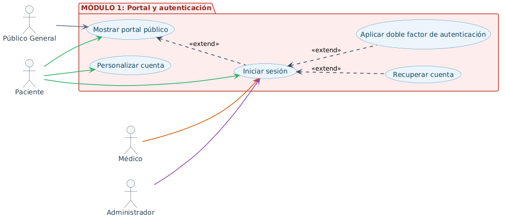

#### Módulo 2: Pacientes
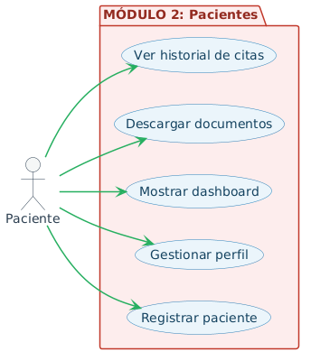

#### Módulo 3: Staff Médico
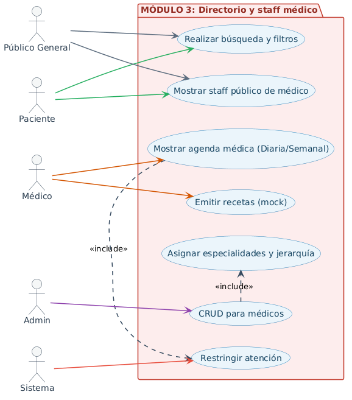

#### Módulo 4: Administración
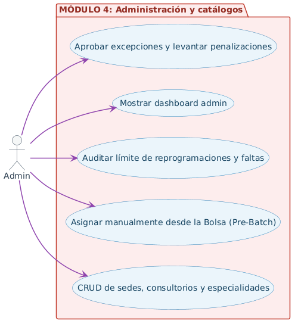

#### Módulo 5: Lógica de Negocio
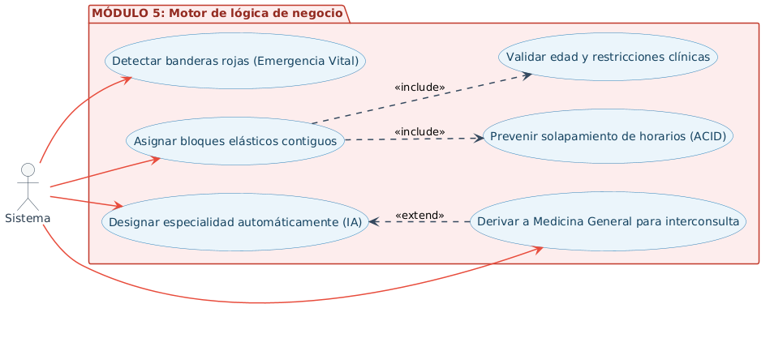

#### Módulo 6: Horarios
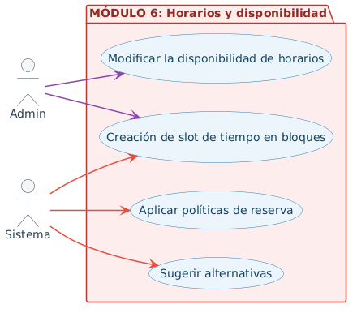

#### Módulo 7: Gestión de Citas
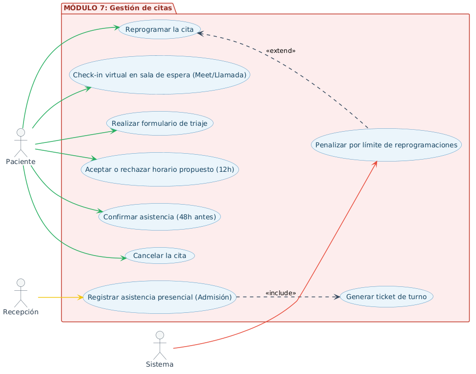

#### Módulo 8: Lista de Espera
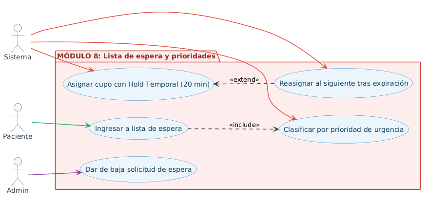

### 2.2 Diagrama de Arquitectura / Componentes
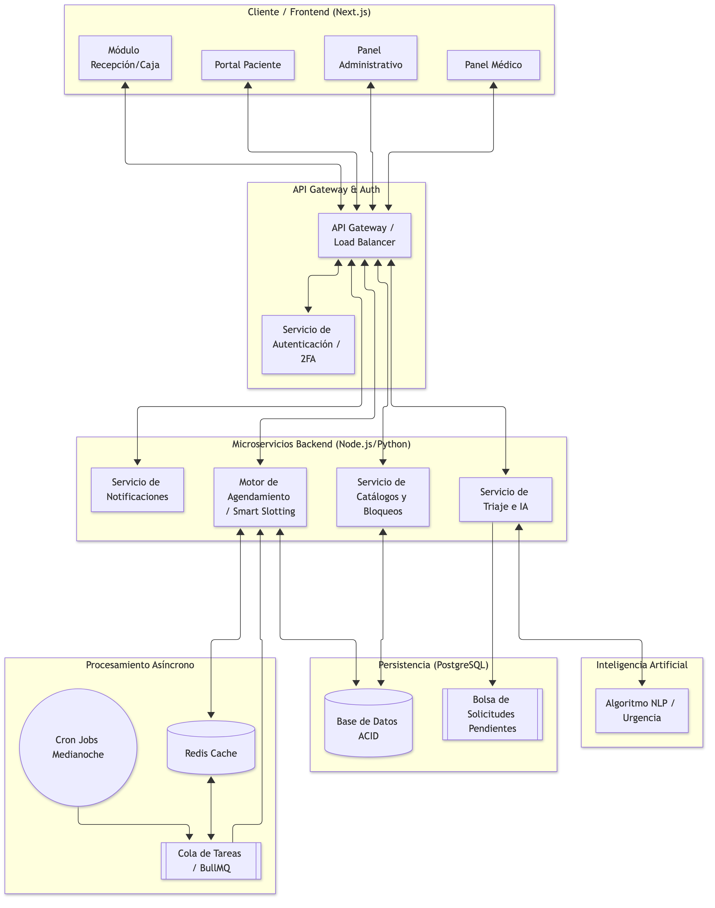

### 2.3 Diagrama Entidad-Relación (DER)
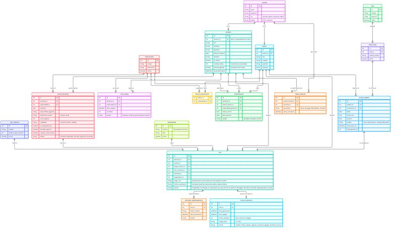

### 2.4 Diagrama de Secuencia (Flujo de Agendamiento)
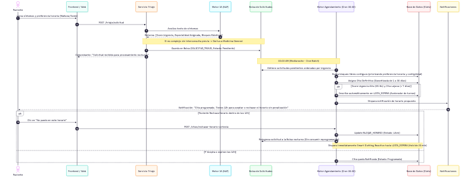

### 2.5 Diagrama de Secuencia (Flujo Reactivo: Cancelación y Lista de Espera)
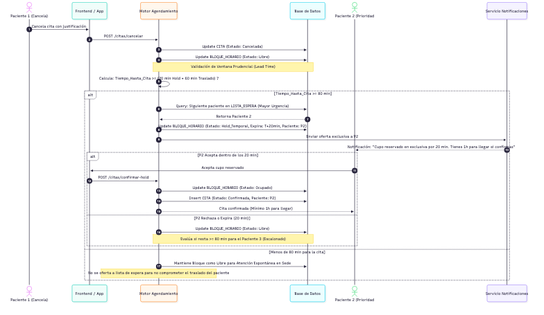

### 2.6 Diagrama de Secuencia (Flujo Lógico: Bloqueos y Límites de Reprogramación)
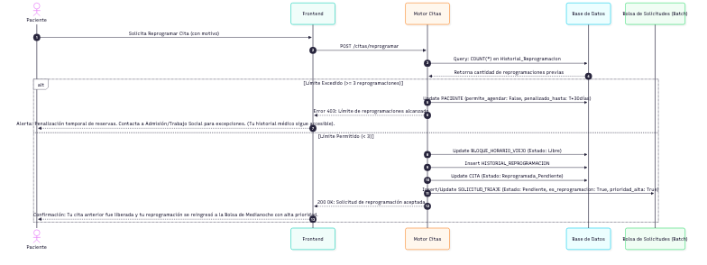

---

## 3. Historias de Usuario

*(Formato: Como [tipo de usuario], quiero [acción] para [beneficio])*

### HU-01: Formulario de Triaje, Cargas Familiares y Control Anti-Acaparamiento
**Como** paciente titular,
**Quiero** completar un formulario para mí o para uno de mis dependientes (cargas familiares), describiendo síntomas y preferencias,
**Para que** el sistema clasifique la especialidad y gestione el turno sin permitir duplicidades abusivas.
*   **Criterios de Aceptación:**
    *   **Selector de Beneficiario (Cargas Familiares):** El usuario titular puede solicitar la cita para sí mismo o para un dependiente vinculado a su cuenta (menor de edad o adulto mayor tutelado sin email propio).
    *   **Control Anti-Acaparamiento:** Se valida que el paciente seleccionado tenga como **máximo 1 solicitud activa generada por la web por especialidad médica**. Si ya tiene una solicitud pendiente, el sistema bloquea el reenvío hasta que la anterior concluya o se cancele.
    *   **Clasificación Automática de Especialidad por IA:** La IA determina si corresponde a atención primaria básica (ej. Odontología, Medicina General) o si requiere interconsulta médica presencial.
    *   Almacenamiento en la Bolsa (`SOLICITUD_TRIAJE`) en estado "Pendiente".

### HU-02: Procesamiento Batch a Medianoche y Ventana de Cortesía (12h)
**Como** administrador del sistema,
**Quiero** que el cron job procese la bolsa a las 12:00 AM asignando citas garantizadas y otorgando una ventana de confirmación,
**Para que** los pacientes reciban un turno justo respetando sus preferencias sin imposiciones arbitrarias.
*   **Criterios de Aceptación:**
    *   Asignación garantizada: El algoritmo busca bloques libres de 1 a 30 días, priorizando la urgencia y la preferencia horaria del paciente.
    *   **Ventana de Cortesía de 12h:** Al publicarse los horarios asignados a medianoche, el paciente tiene hasta las 12:00 PM del día siguiente para revisar la cita. Si el horario le resulta incompatible, puede pulsar "Rechazar Horario" sin penalización (no consume intentos de reprogramación), retornando su solicitud a la Bolsa y **liberando el bloque inmediatamente** para la lista de espera reactiva.

### HU-03: Check-in de Confirmación (48 horas antes)
**Como** clínica,
**Quiero** enviar un recordatorio al paciente 48 horas antes de su cita para que confirme asistencia,
**Para que** reduzcamos el ausentismo (No-Shows).
*   **Criterios de Aceptación:**
    *   Envío automático de SMS/Correo con enlace seguro de check-in express.
    *   Si cancela con justificación, el slot se libera inmediatamente para el motor reactivo.

### HU-04: Contingencia Médica Institucional y Acelerador de Lista de Espera (Hold 20 min)
**Como** paciente afectado por la cancelación de un médico o con cita lejana,
**Quiero** ser reubicado con la máxima prioridad institucional,
**Para que** mi salud no se vea perjudicada por imprevistos de la clínica.
*   **Criterios de Aceptación:**
    *   **Contingencia por Ausencia Médica (3 Escalones):**
        1. *Escalón 1 (Mismo Turno):* Si el médico declara ausencia imprevista, el sistema notifica de inmediato al paciente y busca reasignarlo automáticamente a otro colega disponible de la misma especialidad en esa misma franja.
        2. *Escalón 2 (Acelerador Diurno):* Si no hay colega disponible, el paciente ingresa a la `LISTA_ESPERA` con prioridad máxima para capturar cualquier cupo liberado en el día (Hold de 20 min).
        3. *Escalón 3 (Bolsa Top Priority):* Si concluye la jornada diurna sin cupo reactivo, la solicitud reingresa a la Bolsa nocturna con bandera de máxima urgencia para asignación prioritaria garantizada a las 00:00 AM.
    *   **Acelerador de Turnos Regular:** Pacientes con urgencia alta (65-84) y cita asignada a más de 7 días quedan en `LISTA_ESPERA`. Si se libera un cupo anticipado y restan $\ge 80$ min para la cita, se ofrece en exclusiva por 20 min (asegurando 1h de margen de traslado).

### HU-05: Panel del Médico, Protocolo de Llamado y Rezagados
**Como** médico,
**Quiero** gestionar mis llamados en consultorio con tiempos exactos y emitir diagnósticos e interconsultas,
**Para que** la consulta fluya sin retrasar al resto de pacientes de la jornada.
*   **Criterios de Aceptación:**
    *   **Protocolo de Llamado:** Primer llamado al paciente (notificación push al móvil y timbre en pantalla de TV). Si no ingresa en 3 minutos, se emite un segundo llamado.
    *   **Manejo de Rezagados:** Si tras el segundo llamado el paciente no entra, el médico pasa al siguiente turno y el paciente ausente queda en estado `Rezagado`. Si llega más tarde, solo podrá ser atendido consumiendo los minutos restantes de su bloque original (sin desfasar a otros pacientes). Si su bloque expiró, debe retirarse y se computa `No_Show`.
    *   Emisión de receta médica en PDF y órdenes de `INTERCONSULTA` a especialistas.

### HU-06: Admisión, Registro de Asistencia y Liquidación de No-Shows (Worker Cierre de Jornada)
**Como** personal de admisión y sistema de auditoría hospitalaria,
**Quiero** registrar la llegada física o virtual de pacientes y liquidar inasistencias automáticamente al cerrar el turno del consultorio,
**Para que** no se marquen faltas prematuras a pacientes rezagados y se penalice el ausentismo real.
*   **Criterios de Aceptación:**
    *   **Cita Presencial:** Escaneo de DNI en tótem/recepción y emisión de `TICKET_ASISTENCIA` (Turno T-042).
    *   **Cita Virtual (Meet/Llamada):** Botón "Entrar a Sala de Espera Virtual" disponible 15 min antes, pasando el estado a `En_Sala_Virtual`.
    *   **Liquidación al Cierre de Turno de Consultorio:** Al finalizar el horario de atención del consultorio (ej. 14:00 o 20:00), un worker background audita las citas del bloque. Toda cita que quedó en `Programada`, `Confirmada` o `Rezagado` sin haber pasado a `Atendida` se liquida como `No_Show` y suma `+1` a `PACIENTE.contador_faltas`. Al acumular 2 faltas injustificadas, se activa la suspensión temporal de reserva.

### HU-07: Directorio Médico Público
**Como** usuario público,
**Quiero** buscar y visualizar el staff médico filtrando por especialidad,
**Para que** pueda conocer el perfil de los doctores antes de iniciar el triaje.
*   **Criterios de Aceptación:**
    *   Página de acceso público (sin login) renderizada en servidor (SSR).
    *   Barra de búsqueda en tiempo real con foto, CMP y especialidades.

### HU-08: Gestión de Sedes, Aseguradoras y Asignación Manual Pre-Batch
**Como** administrador,
**Quiero** gestionar el catálogo y poder realizar asignaciones manuales prioritarias desde la Bolsa,
**Para que** casos sociales o excepciones autorizadas puedan resolverse antes del cron nocturno.
*   **Criterios de Aceptación:**
    *   CRUD de Sedes, Consultorios, Aseguradoras y Bloques de Horario.
    *   **Asignación Manual Pre-Batch:** El administrador puede inspeccionar la Bolsa (`SOLICITUD_TRIAJE` en Pendiente) y asignar directamente una solicitud a un `BLOQUE_HORARIO` libre antes de las 00:00 respetando la integridad ACID.

### HU-09: Turnero Digital en Sala de Espera y Notificación Móvil
**Como** paciente en sala de espera,
**Quiero** ver mi turno en pantalla y recibir avisos en mi celular,
**Para que** no pierda mi llamado médico.
*   **Criterios de Aceptación:**
    *   Pantalla de televisión en sala de espera que muestra el turno llamado y consultorio (Turnero digital).
    *   Notificación push al móvil del paciente cuando su turno es llamado.

### HU-10: Reglas de Reprogramación y Penalización por Abuso
**Como** sistema,
**Quiero** limitar las reprogramaciones sin bloquear el acceso del paciente a sus antecedentes de salud,
**Para que** no se perjudique la disponibilidad de cupos de la clínica pública.
*   **Criterios de Aceptación:**
    *   **Reingreso a la Bolsa Nocturna:** Toda reprogramación válida libera inmediatamente el slot anterior y reingresa a la Bolsa con `es_reprogramacion = True` (prioridad alta).
    *   **Límite de 3 Reprogramaciones:** Al superar 3 reprogramaciones, el sistema bloquea nuevas reservas (`PACIENTE.permite_agendar = False` por 30 días), preservando el inicio de sesión y la consulta de recetas históricas.

---

## 4. Desglose en Tareas Técnicas y Backlog Ágil

Para mantener el control del proyecto y facilitar la gestión del equipo de desarrollo, el desglose técnico detallado se ha independizado. En él encontrarás las tareas fundacionales de Infraestructura (Sprint 0) y el mapa técnico de las 10 Historias de Usuario (divididas en Frontend, Backend y DevOps).

Todo ha sido estructurado en "Tickets" listos para ser importados a tableros como Jira o Trello.

👉 **[Ver Backlog Técnico Detallado (Markdown)](diccionarios/backlog_tareas_jira.md)**
👉 **[Ver Archivo CSV de Importación](diccionarios/jira_import.csv)**

---

## 5. Lógica Core: El Motor Inteligente de Agendamiento (Slotting)

El sistema basa su capacidad de orquestación en cuatro pilares lógicos interconectados, garantizando la optimización de los espacios médicos sin solapamientos:

### 5.1 Time-Slotting Estricto (Bloques Fijos)
En lugar de calcular tiempos libres sobre la marcha, la tabla `BLOQUE_HORARIO` se pre-puebla de manera estática con celdas de tiempo fijas (ej. 15 minutos).
*   **Por qué:** Asegura una transaccionalidad ACID perfecta. Asignar un turno consiste simplemente en cambiar el estado de un bloque físico de `"Libre"` a `"Ocupado"`, evitando por completo el solapamiento de horarios bajo concurrencia extrema.

### 5.2 Bloques Elásticos y Detección de Emergencias Vitales
La IA del triaje evalúa no solo la urgencia de la solicitud, sino también su **complejidad**:
*   **Urgencias Vitales (Banderas Rojas):** Si la IA deduce un Score Crítico (ej. dolor torácico, asfixia, sangrado activo), **se bloquea el agendamiento ambulatorio**. El sistema emite una alerta roja inmediata derivando al paciente al Servicio de Urgencias presencial más cercano. No se le hace esperar a procesos batch.
*   **Bloques Elásticos Contiguos:** Si la solicitud es de primer nivel, se le asigna 1 bloque (15 min). Si deduce síntomas complejos o primera consulta, exige 2 o 3 bloques contiguos. El sistema garantiza que los bloques asignados sean siempre contiguos para no fragmentar la agenda médica.

### 5.3 Smart Slotting & Lista de Espera Reactiva con Hold Temporal
*   **A medianoche (Batch 00:00):** El cron job lee la "Bolsa" (solicitudes en `Pendiente`), priorizando por urgencia y solicitudes de reprogramación. Aplica el algoritmo de empaquetamiento garantizando que las asignaciones sean contiguas a las citas ya existentes y dentro de una ventana de 1 a 30 días.
*   **Ventana de Cortesía (12h):** El paciente puede declinar el horario propuesto hasta las 12:00 PM sin penalización. Al hacerlo, el bloque pasa **inmediatamente a `Libre`**, activando de inmediato el motor reactivo de la lista de espera.
*   **Acelerador de Turnos (Hold de 20 min):** Pacientes con urgencia alta y cita lejana quedan en `LISTA_ESPERA`. Si se libera un cupo durante el día y restan $\ge 80$ min para la cita, se ofrece en exclusiva por 20 minutos con margen de traslado garantizado de 1 hora.

### 5.4 Protocolo de Contingencia Institucional (Ausencia Médica en 3 Escalones)
Ante una ausencia de fuerza mayor de un médico, el sistema protege al paciente mediante una cascada automática:
1. **Escalón 1 (Reasignación Inmediata):** Búsqueda sincrónica de médicos de la misma especialidad con bloques libres en esa misma jornada.
2. **Escalón 2 (Acelerador Reactivo):** Si no hay sustituto inmediato, los pacientes pasan a `LISTA_ESPERA` con prioridad máxima para capturar cancelaciones diurnas mediante Hold de 20 min.
3. **Escalón 3 (Top Priority Nocturno):** Si no consiguen cupo diurno, sus solicitudes ingresan a la Bolsa de medianoche como prioridad número 1, garantizando su cita al día siguiente.

---

## 6. Arquitectura y Stack Tecnológico Propuesto

Para satisfacer los requerimientos de SEO (Directorio Médico), procesamiento concurrente asíncrono (Bolsa de Medianoche) y usabilidad en tiempo real, se propone el siguiente stack técnico moderno:

*   **Frontend (UI/UX):**
    *   **Framework:** Next.js (App Router) + React. Ideal por su Server-Side Rendering (SSR) que ayuda al SEO del directorio público, y la rapidez para el panel administrativo.
    *   **Estilos:** TailwindCSS (para diseño rápido y responsive) + Shadcn UI (para componentes accesibles y modernos: modales, tablas, calendarios interactivos).
*   **Backend (API & Lógica):**
    *   **Framework:** Next.js Route Handlers (API robusta dentro del mismo entorno).
    *   **ORM / Base de Datos:** Prisma ORM interactuando con **PostgreSQL**. PostgreSQL es excelente para mantener la integridad relacional (ACID) exigida en los requerimientos financieros y médicos.
*   **Inteligencia Artificial:**
    *   **Modelo:** API de LLM Libre / Abierta (Open Source / Agnostic) para el análisis de lenguaje natural en el triaje de síntomas y deducción de urgencias.
*   **Procesamiento Asíncrono (Batch & Colas):**
    *   **Colas y Caché:** Redis (para mantener la Bolsa de Solicitudes) + **BullMQ** (para orquestar el Cron Job de asignación a medianoche y envío de notificaciones encoladas sin bloquear el servidor principal).
*   **Autenticación y Seguridad:**
    *   **Sistema:** NextAuth.js (Auth.js) para el manejo de sesiones con JWT y validación estricta de Roles (RBAC). Cifrado de contraseñas nativo (Bcrypt).
